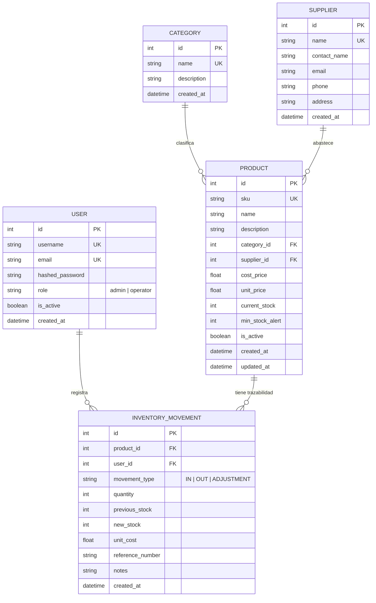

# API de Gestión de Inventario y Almacén 📦

API RESTful moderna, robusta y escalable desarrollada con **Python**, **FastAPI**, **SQLAlchemy 2.0**, **Pydantic v2** y autenticación segura con **JWT**.

---

## 🌟 Características Principales

1. **Seguridad y Control de Accesos (RBAC)**:
   - Autenticación mediante **JWT (JSON Web Tokens)** con contraseñas encriptadas con **bcrypt**.
   - Dos roles diferenciados: `admin` (control total de catálogo, usuarios y configuraciones) y `operator` (gestión operativa de stock y consultas).
   - Inyección de dependencias (`get_current_user`, `require_role`).

2. **Gestión de Catálogo y Entidades**:
   - **Categorías**: Organización jerárquica de productos con validación de nombres duplicados.
   - **Proveedores**: Directorio de proveedores con datos de contacto, teléfonos y direcciones.
   - **Productos**: Manejo de SKU único, precios de coste y venta, stock actual y umbral de alerta de existencias mínimas.

3. **Trazabilidad Atómica de Movimientos de Inventario**:
   - Operaciones soportadas:
     - `IN` (Entrada): Recepción de mercancía que incrementa el stock.
     - `OUT` (Salida): Validación atómica de existencias (evita stock negativo) y descuento de unidades.
     - `ADJUSTMENT` (Ajuste): Corrección o recuento físico directo de auditoría.
   - Cada movimiento registra usuario responsable, stock previo, stock posterior, costo unitario, número de referencia (remito/factura) y notas.

4. **Dashboard y Reportes Financieros en Tiempo Real**:
   - Total de productos, categorías y proveedores.
   - Detección automática y conteo de productos con **Stock Bajo**.
   - Valoración total del inventario tanto a precio de adquisición (costo) como a precio de venta proyectado.
   - Listado de movimientos recientes.

5. **Documentación Automática**:
   - Swagger UI interactivo en `/docs` con soporte para autorizar tokens Bearer.
   - ReDoc alternativo en `/redoc`.

---

## 🏗️ Modelo de Datos (Diagrama Entidad-Relación)



---

## 🚀 Guía de Inicio Rápido

### 1. Requisitos Previos
- Python 3.10 o superior (verificado con Python 3.12).

### 2. Instalación de Dependencias
Si utilizas el entorno virtual `.venv` existente:

```powershell
# En Windows PowerShell
.\.venv\Scripts\Activate.ps1
```

O si deseas instalar en un nuevo entorno:
```bash
python -m venv .venv
source .venv/bin/activate  # En Linux/macOS
.\.venv\Scripts\activate   # En Windows
pip install -r requirements.txt
```

### 3. Cargar Datos de Prueba (Seeding)
Para poblar la base de datos con usuarios, categorías, proveedores y productos con stock:

```bash
python seed_data.py
```

> **Credenciales de Prueba Creadas:**
> - **Administrador**:
>   - Usuario: `admin`
>   - Contraseña: `Admin123!`
> - **Operador**:
>   - Usuario: `operador1`
>   - Contraseña: `Operador123!`

### 4. Iniciar el Servidor de Desarrollo
```powershell
.\.venv\Scripts\uvicorn app.main:app --reload --port 8000
```

Abre en tu navegador:
- **Documentación Interactiva (Swagger UI)**: [http://127.0.0.1:8000/docs](http://127.0.0.1:8000/docs)
- **Documentación Alternativa (ReDoc)**: [http://127.0.0.1:8000/redoc](http://127.0.0.1:8000/redoc)

---

## 🧪 Ejecución de Pruebas Automatizadas

El proyecto incluye una suite completa de pruebas unitarias y de integración que utiliza una base de datos SQLite en memoria aislada:

```powershell
.\.venv\Scripts\python -m pytest -v
```

Resultado esperado:
```text
tests/test_auth.py::test_login_successful PASSED
tests/test_auth.py::test_login_invalid_password PASSED
tests/test_auth.py::test_get_current_user_me PASSED
tests/test_auth.py::test_unauthenticated_request_fails PASSED
tests/test_auth.py::test_operator_cannot_access_admin_user_list PASSED
tests/test_inventory.py::test_create_category_and_supplier PASSED
tests/test_inventory.py::test_operator_forbidden_create_category PASSED
tests/test_inventory.py::test_product_lifecycle_and_stock_movements PASSED
```

---

## 📡 Endpoints Principales

### Autenticación y Usuarios (`/api/v1/auth`)
| Método | Endpoint | Rol Requerido | Descripción |
|---|---|---|---|
| `POST` | `/api/v1/auth/login` | Público | Obtener token de acceso JWT (form OAuth2) |
| `POST` | `/api/v1/auth/register` | Público | Registrar usuario (el primero creado será admin) |
| `GET` | `/api/v1/auth/me` | Cualquier autenticado | Obtener información del usuario autenticado |
| `GET` | `/api/v1/auth/users` | `admin` | Listar usuarios del sistema |
| `PATCH` | `/api/v1/auth/users/{id}` | `admin` | Modificar rol o activar/desactivar usuario |

### Categorías y Proveedores (`/api/v1/categories`, `/api/v1/suppliers`)
| Método | Endpoint | Rol Requerido | Descripción |
|---|---|---|---|
| `GET` | `/api/v1/categories` | Autenticado | Listar categorías |
| `POST` | `/api/v1/categories` | `admin` | Crear categoría |
| `PUT` | `/api/v1/categories/{id}` | `admin` | Actualizar categoría |
| `DELETE` | `/api/v1/categories/{id}` | `admin` | Eliminar categoría |
| `GET` | `/api/v1/suppliers` | Autenticado | Listar proveedores |
| `POST` | `/api/v1/suppliers` | `admin` | Registrar nuevo proveedor |
| `PUT` | `/api/v1/suppliers/{id}` | `admin` | Actualizar información de proveedor |
| `DELETE` | `/api/v1/suppliers/{id}` | `admin` | Eliminar proveedor |

### Productos (`/api/v1/products`)
| Método | Endpoint | Rol Requerido | Descripción |
|---|---|---|---|
| `GET` | `/api/v1/products` | Autenticado | Listar con filtros (`category_id`, `supplier_id`, `low_stock_only`, `search`) |
| `GET` | `/api/v1/products/{id}` | Autenticado | Ver detalle de producto con categoría y proveedor |
| `POST` | `/api/v1/products` | `admin` | Crear nuevo producto (registra movimiento inicial si stock > 0) |
| `PUT` | `/api/v1/products/{id}` | `admin` | Actualizar datos, precio o umbrales de stock |
| `DELETE` | `/api/v1/products/{id}` | `admin` | Desactivar o eliminar producto |

### Movimientos de Inventario (`/api/v1/movements`)
| Método | Endpoint | Rol Requerido | Descripción |
|---|---|---|---|
| `POST` | `/api/v1/movements` | Autenticado | Registrar entrada (`IN`), salida (`OUT`) o ajuste (`ADJUSTMENT`) |
| `GET` | `/api/v1/movements` | Autenticado | Historial de transacciones de stock con filtros |
| `GET` | `/api/v1/movements/{id}` | Autenticado | Detalle de un movimiento de inventario |

### Dashboard y Métricas (`/api/v1/dashboard`)
| Método | Endpoint | Rol Requerido | Descripción |
|---|---|---|---|
| `GET` | `/api/v1/dashboard/summary` | Autenticado | Métricas globales: valoración de almacén, existencias y alertas |

---

## 💡 Ejemplos con cURL

### 1. Iniciar Sesión (Login)
```bash
curl -X POST "http://127.0.0.1:8000/api/v1/auth/login" \
     -H "Content-Type: application/x-www-form-urlencoded" \
     -d "username=admin&password=Admin123!"
```
Respuesta:
```json
{
  "access_token": "eyJhbGciOi...",
  "token_type": "bearer"
}
```

### 2. Consultar Productos con Alerta de Stock Bajo
```bash
curl -X GET "http://127.0.0.1:8000/api/v1/products?low_stock_only=true" \
     -H "Authorization: Bearer <TU_TOKEN_AQUI>"
```

### 3. Registrar una Salida de Inventario (OUT)
```bash
curl -X POST "http://127.0.0.1:8000/api/v1/movements" \
     -H "Authorization: Bearer <TU_TOKEN_AQUI>" \
     -H "Content-Type: application/json" \
     -d '{
       "product_id": 1,
       "movement_type": "OUT",
       "quantity": 2,
       "reference_number": "VENTA-2026-001",
       "notes": "Despacho a sucursal norte"
     }'
```

### 4. Consultar Resumen Financiero del Almacén (Dashboard)
```bash
curl -X GET "http://127.0.0.1:8000/api/v1/dashboard/summary" \
     -H "Authorization: Bearer <TU_TOKEN_AQUI>"
```
